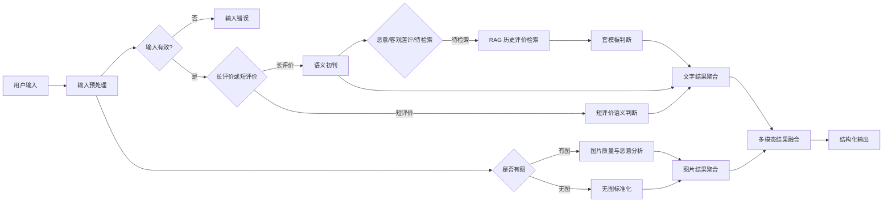

# 电商多模态评价智能分级 Agent

基于 Dify 搭建的电商评价质量审核工作流，对评价文字和图片进行联合判断，输出高质量评价、普通低信息评价、客观差评与恶意评价等结构化结果。

## 在线体验

- [打开 Dify Web 应用](https://udify.app/workflow/Xu2TC8zdAz5FMU9L)

## 解决的问题

传统关键词规则难以区分客观差评、情绪攻击、套模板好评和真实高质量评价。本项目将确定性规则、大模型语义判断、RAG 历史评价检索和视觉理解组合成一条可解释的审核链路，并通过统一的 JSON 结果供业务系统调用。

## 核心能力

- 按 60 字阈值对长短评价分流，减少不必要的模型调用。
- 识别辱骂攻击、广告导流、明显无关、拼写混乱及凑字数等恶意类型。
- 保护包含真实商品问题的客观差评，避免因负面情绪直接屏蔽。
- 使用商品级历史长评价知识库检测固定结构复用和少量词语替换。
- 审核正常商品图、模糊图、无关图与广告导流图，并支持多图判断。
- 融合文字与图片结论，异常时转入人工复核。
- 通过 Dify Workflow API 返回统一、可解释的结构化结果。

## 工作流



## 技术方案

| 模块 | 实现 |
|---|---|
| 编排 | Dify Workflow |
| 中文语义与视觉判断 | DeepSeek V4.1 Flash 系列模型 |
| 向量模型 | 通义 `text-embedding-v4` |
| 重排序 | 通义 `qwen3-rerank` |
| 知识库隔离 | 使用 `product_id` 元数据过滤 |
| 稳定性处理 | Python 解析、类型标准化、异常兜底与人工复核 |

## 输出示例

```json
{
  "review_id": "review_20261007_002",
  "product_id": "product_001",
  "final_is_malicious": false,
  "final_quality": "high_quality",
  "final_category": "高质量评价",
  "final_evidence": "评价包含具体使用细节，未发现模板复用。",
  "final_reason": "文字与商品相关，图片为正常商品图。",
  "final_status": "decided"
}
```

## 仓库结构

```text
workflow/          Dify DSL，可导入 Dify
docs/              产品方案、验收报告与参考文档
knowledge/         脱敏后的知识库样例
test-data/images/  图片审核测试样例
examples/          API 请求与响应示例
scripts/           API 调用示例
```

## 本地调用

1. 将 `.env.example` 复制为 `.env`，填入自己的 Dify API Key。
2. 安装依赖：`pip install requests python-dotenv`。
3. 运行：`python scripts/call_workflow.py`。

不要提交 `.env`、API Key、模型供应商凭证或真实用户数据。

## 导入 Dify

在 Dify 工作室中选择“导入 DSL”，上传 `workflow/ecommerce-review-agent.yml`。导入后需要重新配置模型供应商凭证，并创建或绑定商品历史评价知识库。

## 验收结果

核心文字、图片与多模态组合场景均已通过人工验收。详细用例见 [测试报告](docs/test-report.md)。

## License

[MIT](LICENSE)
